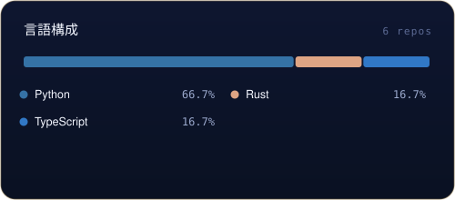

[English](README.md) | [中文](README.zh-CN.md) | [日本語](README.ja.md)

  

  

First, solve the problem. Then, write the code. — John Johnson

<table border="0">
<tr>
<td valign="top" width="58%">

### について

GitHub の拠点 — ツール・索引・小さなソフトウェア実験を公開しています。オフライン優先・シングルファイルな道具が好きです。

</td>
<td valign="top" width="42%">

### 近況

- API-Market / MCP-HUB 索引のデータ整備
- digilegacy と spark の継続開発
- 49 種のツール集（DU）のドキュメント整備

</td>
</tr>
</table>

## 道具箱

  

## 主な作品

| プロジェクト | スター | 更新日 |
| --- | --- | --- |
| [world-walker — World Walker 万界·行者 — 世界观无关的 AI 文字互动游戏内核：确定性规则结算 + 34…](https://github.com/badhope/world-walker) | 18 | 2026-10-30 |
| [rubbish — ScholarHub — multi-tenant academic journal &amp; preprint pla…](https://github.com/badhope/rubbish) | 4 | 2026-10-30 |
| [moneyhelper — Moneyhelper ｜ 算清每一笔，攒稳每一步 —— 对话优先的个人理财智能体：一句话记账、持仓风控、…](https://github.com/badhope/moneyhelper) | 86 | 2026-10-29 |
| [sciflow — SciFlow - fully automated AI research assistant: local-fi…](https://github.com/badhope/sciflow) | 11 | 2026-10-29 |
| [rules — Portable AI working contract: rules, 71 skills, 220 subagen…](https://github.com/badhope/rules) | 0 | 2026-10-29 |
| [digilegacy — DigiLegacy 归零 — open-source, local-first digital legac…](https://github.com/badhope/digilegacy) | 6 | 2026-10-28 |

全公開リポジトリ： [github.com/badhope](https://github.com/badhope)

## 数字で見る

  
  
  

  
  

  

## 実績

  

  

オープンソース

パッチは ohmyzsh・tldr・icalendar・NUR などにマージ済み — 詳細は GitHub の2アカウントへ: [X33834](https://github.com/X33834) · [Morningstar202604](https://github.com/Morningstar202604)

## 執筆

| 日付 | 記事 |
|---|---|
| 2026-10-18 | [Gemini 4 Argon 全面开放：谷歌憋了半年的旗舰大招，到底行不行？](https://blog.csdn.net/weixin_56622231/article/details/168251657) |
| 2026-10-16 | [MCP 落地一年，我总结了 6 个没人告诉你的工程真相](https://zhuanlan.zhihu.com/p/2094232145015453253) |
| 2026-10-16 | [本地优先 AI：当所有人都在上云，我为什么把 AI 装回自己电脑](https://zhuanlan.zhihu.com/p/2094233605513991576) |
| 2026-10-16 | [AI Agent 上线前必须过的 5 道关：一个真实项目的工程手记](https://zhuanlan.zhihu.com/p/2094218858789856836) |
| 2026-09-27 | [Playwright 多平台分发：8 个踩坑与合规门禁](https://blog.csdn.net/weixin_56622231/article/details/166698802) |

同時掲載  <a href="https://blog.csdn.net/weixin_56622231">CSDN</a> ·  <a href="https://juejin.cn/user/2350111542479753">Juejin</a> ·  <a href="https://www.zhihu.com/people/e7c851hd">Zhihu</a>

## ほかの場所

> 同一人物の5つの拠点 — これらのアカウントは同じ人のミラーです。

| | プラットフォーム | アカウント | 役割 |
|---|---|---|---|
|  | GitHub | **[X33834](https://github.com/X33834)** | 上流 OSS · ツールと作品 |
|  | GitHub | **[Morningstar202604](https://github.com/Morningstar202604)** | ポートフォリオ · 長期プロジェクト |
|  | GitHub | **[badhope](https://github.com/badhope)** | プロフィール · ツール小屋 ◆ *現在地* |
|  | GitCode | **[badhope](https://gitcode.com/badhope)** | モバイル開発 · オフラインツール |
|  | Gitee | **[badhope](https://gitee.com/badhope)** | ミラー · ミニアプリ |

  

© badhope

