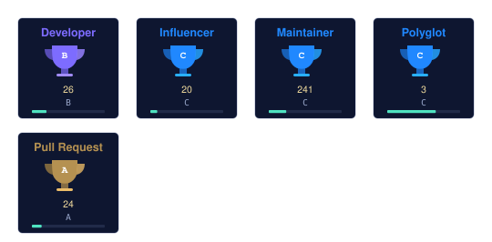

[English](README.md) | [中文](README.zh-CN.md) | [日本語](README.ja.md)

  

  

まず問題を解き、それからコードを書く。 — John Johnson

<table border="0">
<tr>
<td valign="top" width="58%">

### について

GitHub の拠点 — ツール・索引・小さなソフトウェア実験を公開しています。オフライン優先・シングルファイルな道具が好きです。

</td>
<td valign="top" width="42%">

### 近況

- API-Market / MCP-HUB 索引のデータ整備
- digilegacy と spark の継続開発
- 49 種のツール集（DU）のドキュメント整備

</td>
</tr>
</table>

## 道具箱

  

## 主な作品

| プロジェクト | スター | 更新日 |
| --- | --- | --- |
| [world-walker — AI 駆動のテキストインタラクティブ小説エンジン](https://github.com/badhope/world-walker) | 18 | 2026-10-30 |
| [rubbish — 学術ジャーナル・プレプリントのマルチテナント基盤](https://github.com/badhope/rubbish) | 4 | 2026-10-30 |
| [moneyhelper — 会話ファーストの個人金融エージェント — ローカル優先・LangGraph 編成](https://github.com/badhope/moneyhelper) | 86 | 2026-10-29 |
| [sciflow — ローカル優先の AI 研究エージェント作業台 — マルチエージェント編成](https://github.com/badhope/sciflow) | 11 | 2026-10-29 |
| [rules](https://github.com/badhope/rules) | 0 | 2026-10-29 |
| [digilegacy — ローカル優先のデジタル遺産管理](https://github.com/badhope/digilegacy) | 6 | 2026-10-28 |

全公開リポジトリ： [github.com/badhope](https://github.com/badhope)

## 数字で見る

  
  
  

  
  

## 実績

  

  

オープンソース

パッチは ohmyzsh・tldr・icalendar・NUR などにマージ済み — 詳細は GitHub の2アカウントへ: [X33834](https://github.com/X33834) · [Morningstar202604](https://github.com/Morningstar202604)

## ピン留め作品

  
  
  

## 執筆

| 日付 | 記事 |
|---|---|
| 2026-10-18 | [Gemini 4 Argon が全面公開：半年ぶりの Google フラッグシップは期待に応えるか？](https://blog.csdn.net/weixin_56622231/article/details/168251657) |
| 2026-10-16 | [MCP 実装1年で分かった、誰も教えてくれなかった6つの現実](https://zhuanlan.zhihu.com/p/2094232145015453253) |
| 2026-10-16 | [ローカルファースト AI：なぜ AI を自分の PC に戻したのか](https://zhuanlan.zhihu.com/p/2094233605513991576) |
| 2026-10-16 | [AI Agent を公開する前に越える5つの関門：実案件の記録](https://zhuanlan.zhihu.com/p/2094218858789856836) |
| 2026-09-27 | [Playwright のマルチプラットフォーム配布：8つの落とし穴とコンプライアンスゲート](https://blog.csdn.net/weixin_56622231/article/details/166698802) |

同時掲載  <a href="https://blog.csdn.net/weixin_56622231">CSDN</a> ·  <a href="https://juejin.cn/user/2350111542479753">Juejin</a> ·  <a href="https://www.zhihu.com/people/e7c851hd">Zhihu</a>

## ほかの場所

> 同一人物の5つの拠点 — これらのアカウントは同じ人のミラーです。

| | プラットフォーム | アカウント | 役割 |
|---|---|---|---|
|  | GitHub | **[X33834](https://github.com/X33834)** | 上流 OSS · ツールと作品 |
|  | GitHub | **[Morningstar202604](https://github.com/Morningstar202604)** | ポートフォリオ · 長期プロジェクト |
|  | GitHub | **[badhope](https://github.com/badhope)** | プロフィール · ツール小屋 ◆ *現在地* |
|  | GitCode | **[badhope](https://gitcode.com/badhope)** | モバイル開発 · オフラインツール |
|  | Gitee | **[badhope](https://gitee.com/badhope)** | ミラー · ミニアプリ |

  

© badhope

