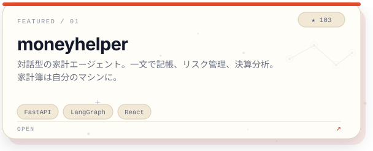
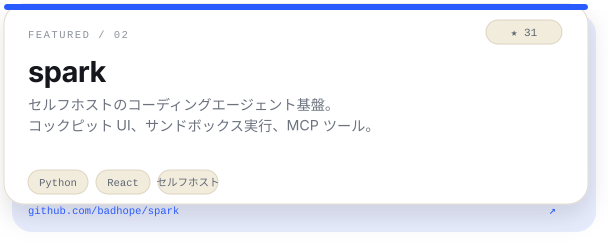
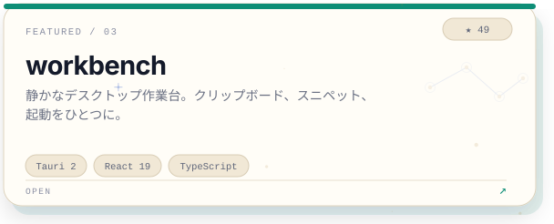
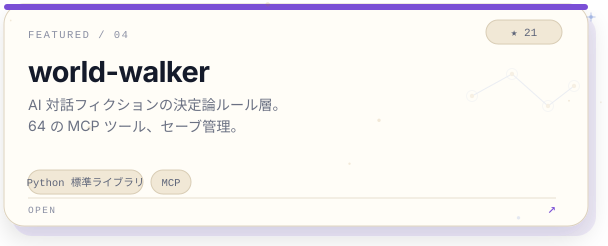
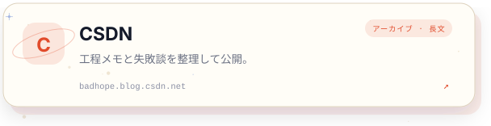

<a href="README.md">English</a> · <a href="README.zh-CN.md">中文</a> · <b>日本語</b>

<picture><source media="(prefers-color-scheme: dark)" srcset="assets/hero-ja-dark.svg" /></picture>

## 01 · いま

- **moneyhelper** —— 対話型の家計エージェント。ローカル完結、数値は検証可能
- **workbench** —— Tauri 2 + React のデスクトップ作業台
- **配信ライン** —— CSDN 長文と Juejin の短文を自動投稿。この二経路だけ

## 02 · 代表作

<a href="https://github.com/badhope/moneyhelper"><picture><source media="(prefers-color-scheme: dark)" srcset="assets/work-1-ja-dark.svg" /></picture></a> <a href="https://github.com/badhope/spark"><picture><source media="(prefers-color-scheme: dark)" srcset="assets/work-2-ja-dark.svg" /></picture></a>

<a href="https://github.com/badhope/workbench"><picture><source media="(prefers-color-scheme: dark)" srcset="assets/work-3-ja-dark.svg" /></picture></a> <a href="https://github.com/badhope/world-walker"><picture><source media="(prefers-color-scheme: dark)" srcset="assets/work-4-ja-dark.svg" /></picture></a>

## 03 · 数字

<picture><source media="(prefers-color-scheme: dark)" srcset="assets/numbers-ja-dark.svg" /></picture>

## 04 · 配信ライン

<a href="https://blog.csdn.net/weixin_56622231"><picture><source media="(prefers-color-scheme: dark)" srcset="assets/channel-csdn-ja-dark.svg" /></picture></a> <a href="https://juejin.cn/user/2350111542479753"><picture><source media="(prefers-color-scheme: dark)" srcset="assets/channel-juejin-ja-dark.svg" /></picture></a>

- 2026-11-04 — [把 AI Agent 接进业务系统，我踩了 3 个挺蠢的坑](https://blog.csdn.net/weixin_56622231/article/details/170051167)
- 2026-10-18 — [Gemini 4 Argon 全面开放：谷歌憋了半年的旗舰大招，到底行不行？](https://blog.csdn.net/weixin_56622231/article/details/168251657)

<a href="https://blog.csdn.net/weixin_56622231">CSDN の全記事 →</a>

## 05 · 棚の続き

> [DU](https://github.com/badhope/DU) · [mashang](https://github.com/badhope/mashang) · [digilegacy](https://github.com/badhope/digilegacy) · [harbor](https://github.com/badhope/harbor) · [sciflow](https://github.com/badhope/sciflow) · [pocketmind](https://github.com/badhope/pocketmind) · [aquapilot](https://github.com/badhope/aquapilot) · [melee](https://github.com/badhope/melee)

Upstream: [ohmyzsh](https://github.com/ohmyzsh/ohmyzsh) · [icalendar](https://github.com/python-icalendar/icalendar) · [apache/airflow](https://github.com/apache/airflow) · [renovate-operator](https://github.com/mogenius/renovate-operator)

One source, five profiles · numbers from a local snapshot

すべてのリポジトリ: [github.com/badhope](https://github.com/badhope)
