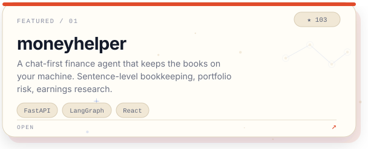
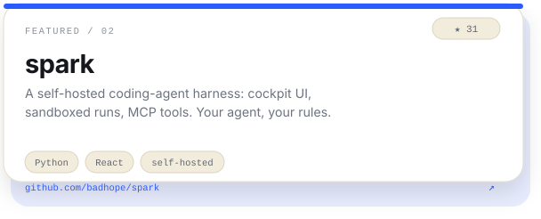
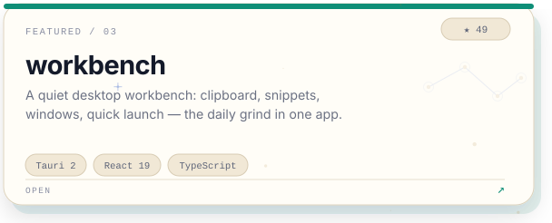
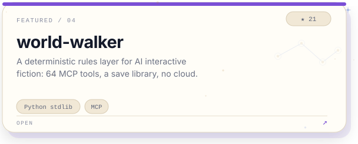
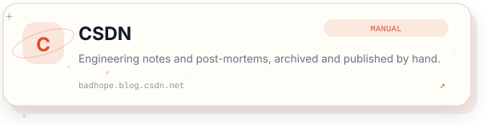

<b>English</b> · <a href="README.zh-CN.md">中文</a> · <a href="README.ja.md">日本語</a>

<picture><source media="(prefers-color-scheme: dark)" srcset="assets/hero-en-dark.svg" /></picture>

## 01 · Now

- **moneyhelper** — a chat-first personal finance agent; local-first, every number auditable
- **workbench** — a Tauri 2 + React desktop workbench that keeps the daily grind in one window
- **Publishing line** — CSDN long-form and Juejin notes, automated; these two channels only

## 02 · Selected work

<a href="https://github.com/badhope/moneyhelper"><picture><source media="(prefers-color-scheme: dark)" srcset="assets/work-1-en-dark.svg" /></picture></a> <a href="https://github.com/badhope/spark"><picture><source media="(prefers-color-scheme: dark)" srcset="assets/work-2-en-dark.svg" /></picture></a>

<a href="https://github.com/badhope/workbench"><picture><source media="(prefers-color-scheme: dark)" srcset="assets/work-3-en-dark.svg" /></picture></a> <a href="https://github.com/badhope/world-walker"><picture><source media="(prefers-color-scheme: dark)" srcset="assets/work-4-en-dark.svg" /></picture></a>

## 03 · Numbers

<picture><source media="(prefers-color-scheme: dark)" srcset="assets/numbers-en-dark.svg" /></picture>

## 04 · Publishing line

<a href="https://blog.csdn.net/weixin_56622231"><picture><source media="(prefers-color-scheme: dark)" srcset="assets/channel-csdn-en-dark.svg" /></picture></a> <a href="https://juejin.cn/user/2350111542479753"><picture><source media="(prefers-color-scheme: dark)" srcset="assets/channel-juejin-en-dark.svg" /></picture></a>

- 2026-11-04 — [把 AI Agent 接进业务系统，我踩了 3 个挺蠢的坑](https://blog.csdn.net/weixin_56622231/article/details/170051167)
- 2026-10-18 — [Gemini 4 Argon 全面开放：谷歌憋了半年的旗舰大招，到底行不行？](https://blog.csdn.net/weixin_56622231/article/details/168251657)

<a href="https://blog.csdn.net/weixin_56622231">All posts on CSDN →</a>

## 05 · Also on the shelf

> [DU](https://github.com/badhope/DU) · [mashang](https://github.com/badhope/mashang) · [digilegacy](https://github.com/badhope/digilegacy) · [harbor](https://github.com/badhope/harbor) · [sciflow](https://github.com/badhope/sciflow) · [pocketmind](https://github.com/badhope/pocketmind) · [aquapilot](https://github.com/badhope/aquapilot) · [melee](https://github.com/badhope/melee)

Upstream: [ohmyzsh](https://github.com/ohmyzsh/ohmyzsh) · [icalendar](https://github.com/python-icalendar/icalendar) · [apache/airflow](https://github.com/apache/airflow) · [renovate-operator](https://github.com/mogenius/renovate-operator)

One source, five profiles · numbers from a local snapshot

All public repositories: [github.com/badhope](https://github.com/badhope)
