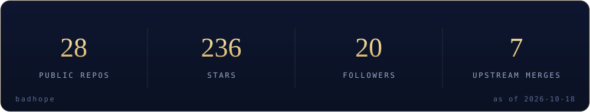

[English](README.md) | [中文](README.zh-CN.md) | [日本語](README.ja.md)

  

<i>A full-stack developer turning abstract ideas into working interfaces.</i>

First, solve the problem. Then, write the code. — John Johnson

## About

My GitHub home — tools, indexes and small software experiments, all in the open. I like offline-first, single-file things that just run; the craft is in the details.

### Now

- Maintaining the API-Market and MCP-HUB indexes
- Advancing digilegacy and spark
- Documenting the 49-tool DU collection

## Selected work

- **[DigiLegacy 归零](https://github.com/badhope/digilegacy)** — Local-first digital legacy planner · `Tools · Privacy`
- **[Spark](https://github.com/badhope/spark)** — Local-first AI coding agent — approval gate, prompt-injection defence · `AI · DevTools`
- **[Agent Builder](https://github.com/badhope/agent-builder)** — Production-grade AI agent reference — 24 TypeScript guides · `AI · Guides`
- **[Workbench](https://github.com/badhope/workbench)** — A local-first desktop workbench (Tauri 2 + React 19) with live tooling · `Desktop · Productivity`
- **[SciFlow](https://github.com/badhope/sciflow)** — Local-first AI research agent workbench — multi-agent pipeline, planner, memory · `AI · Research`
- **[DU 渡](https://github.com/badhope/DU)** — A client-side Chinese metaphysics toolkit — 49 tools · `Tools · Culture`
- **[API Market](https://github.com/badhope/API-Market)** — A searchable catalogue of 14,000+ public APIs · `Data · Index`
- **[MCP Hub](https://github.com/badhope/MCP-HUB)** — A curated registry of 4,400+ MCP servers and resources · `AI · Index`

All public repositories: [github.com/badhope](https://github.com/badhope)

## Open source

Patches merged upstream into ohmyzsh, tldr, icalendar, NUR and more — details on the two GitHub accounts: [X33834](https://github.com/X33834) · [Morningstar202604](https://github.com/Morningstar202604)

## Numbers

  

## Contribution graph

  <picture>
    <source media="(prefers-color-scheme: dark)" srcset="./assets/github-contribution-grid-snake-dark.svg" />
    
  </picture>

## Writing

### Latest writing

- [Playwright 多平台分发：8 个踩坑与合规门禁](https://blog.csdn.net/weixin_56622231/article/details/166698802) · `2026-09-27`
- [AI Agent 智能体开发从零到一：2026年程序员完整学习路线与实战指南](https://blog.csdn.net/weixin_56622231/article/details/166643070) · `2026-09-25`
- [工作流体检验收：全链路发布完整性验证](https://blog.csdn.net/weixin_56622231/article/details/166254273) · `2026-09-21`
- [Python协程全景解析：从原理到生产实战](https://blog.csdn.net/weixin_56622231/article/details/166252941) · `2026-09-21`
- [【分布式第一课】从单机到百万级并发：一小时带你看懂分布式系统的前世今生](https://blog.csdn.net/weixin_56622231/article/details/165435117) · `2026-09-15`

- [CSDN](https://blog.csdn.net/weixin_56622231) · [Juejin](https://juejin.cn/user/2350111542479753)

## Elsewhere

> One identity, five homes — these five accounts mirror the same person.

- **GitHub · [X33834](https://github.com/X33834)** — Upstream OSS · tools and works
- **GitHub · [Morningstar202604](https://github.com/Morningstar202604)** — Portfolio · long-horizon works
- **GitHub · [badhope](https://github.com/badhope)** — Profile · full-stack toolshop ◆ you are here
- **GitCode · [badhope](https://gitcode.com/badhope)** — Mobile dev · offline tools
- **Gitee · [badhope](https://gitee.com/badhope)** — Mirror · mini-programs

  

© badhope

