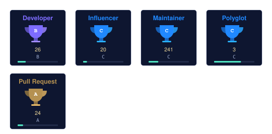

[English](README.md) | [中文](README.zh-CN.md) | [日本語](README.ja.md)

  

  

First, solve the problem. Then, write the code. — John Johnson

<table border="0">
<tr>
<td valign="top" width="58%">

### About

My GitHub home — tools, indexes and small software experiments, all in the open. I like offline-first, single-file things that just run; the craft is in the details.

</td>
<td valign="top" width="42%">

### Now

- Maintaining the API-Market and MCP-HUB indexes
- Advancing digilegacy and spark
- Documenting the 49-tool DU collection

</td>
</tr>
</table>

## Toolbox

  

## Selected work

| Project | Stars | Updated |
| --- | --- | --- |
| [world-walker — AI-driven interactive text fiction engine](https://github.com/badhope/world-walker) | 18 | 2026-10-30 |
| [rubbish — Multi-tenant journal and preprint platform — submission /…](https://github.com/badhope/rubbish) | 4 | 2026-10-30 |
| [moneyhelper — Chat-first personal finance agent — local-first, Lang…](https://github.com/badhope/moneyhelper) | 86 | 2026-10-29 |
| [sciflow — Local-first AI research agent workbench — multi-agent pip…](https://github.com/badhope/sciflow) | 11 | 2026-10-29 |
| [rules — Portable AI working contract: rules, 71 skills, 220 subagen…](https://github.com/badhope/rules) | 0 | 2026-10-29 |
| [digilegacy — Local-first digital legacy planner](https://github.com/badhope/digilegacy) | 6 | 2026-10-28 |

All public repositories: [github.com/badhope](https://github.com/badhope)

## Numbers

  
  
  

  
  

## Achievements

  

  

Open source

Patches merged upstream into ohmyzsh, tldr, icalendar, NUR and more — details on the two GitHub accounts: [X33834](https://github.com/X33834) · [Morningstar202604](https://github.com/Morningstar202604)

## Pinned work

  
  
  

## Writing

| Date | Article |
|---|---|
| 2026-10-18 | [Gemini 4 Argon Opens to Everyone: Can Google's Half-Year Flagship Deliver?](https://blog.csdn.net/weixin_56622231/article/details/168251657) |
| 2026-10-16 | [A Year of MCP in Production: Six Engineering Truths Nobody Told Me](https://zhuanlan.zhihu.com/p/2094232145015453253) |
| 2026-10-16 | [Local-First AI: Why I Put AI Back on My Own Computer](https://zhuanlan.zhihu.com/p/2094233605513991576) |
| 2026-10-16 | [Five Gates Before Shipping an AI Agent: Notes from a Real Project](https://zhuanlan.zhihu.com/p/2094218858789856836) |
| 2026-09-27 | [Cross-Platform Playwright Delivery: Eight Pitfalls and Compliance Gates](https://blog.csdn.net/weixin_56622231/article/details/166698802) |

Also on  <a href="https://blog.csdn.net/weixin_56622231">CSDN</a> ·  <a href="https://juejin.cn/user/2350111542479753">Juejin</a> ·  <a href="https://www.zhihu.com/people/e7c851hd">Zhihu</a>

## Elsewhere

> One identity, five homes — these five accounts mirror the same person.

| | Platform | Account | Role |
|---|---|---|---|
|  | GitHub | **[X33834](https://github.com/X33834)** | Upstream OSS · tools and works |
|  | GitHub | **[Morningstar202604](https://github.com/Morningstar202604)** | Portfolio · long-horizon works |
|  | GitHub | **[badhope](https://github.com/badhope)** | Profile · full-stack toolshop ◆ *you are here* |
|  | GitCode | **[badhope](https://gitcode.com/badhope)** | Mobile dev · offline tools |
|  | Gitee | **[badhope](https://gitee.com/badhope)** | Mirror · mini-programs |

  

© badhope

