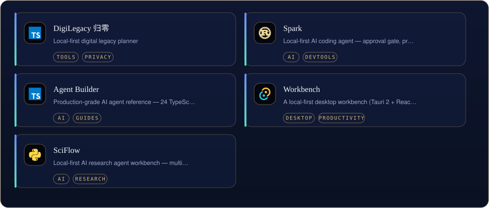

[English](README.md) | [中文](README.zh-CN.md) | [日本語](README.ja.md)

  

<i>A full-stack developer turning abstract ideas into working interfaces.</i>

First, solve the problem. Then, write the code. — John Johnson

<table border="0">
<tr>
<td valign="top" width="58%">

### About

My GitHub home — tools, indexes and small software experiments, all in the open. I like offline-first, single-file things that just run; the craft is in the details.

</td>
<td valign="top" width="42%">

### Now

- Maintaining the API-Market and MCP-HUB indexes
- Advancing digilegacy and spark
- Documenting the 49-tool DU collection

</td>
</tr>
</table>

## Toolbox

  

## Selected work

  

<a href="https://github.com/badhope/digilegacy">DigiLegacy 归零</a> · <a href="https://github.com/badhope/spark">Spark</a> · <a href="https://github.com/badhope/agent-builder">Agent Builder</a> · <a href="https://github.com/badhope/workbench">Workbench</a> · <a href="https://github.com/badhope/sciflow">SciFlow</a> · <a href="https://github.com/badhope/DU">DU 渡</a> · <a href="https://github.com/badhope/API-Market">API Market</a> · <a href="https://github.com/badhope/MCP-HUB">MCP Hub</a>

All public repositories: [github.com/badhope](https://github.com/badhope)

## Numbers

  
  

  
  

## Pinned work

  
  
  

## Contribution graph

  <picture>
    <source media="(prefers-color-scheme: dark)" srcset="./assets/github-contribution-grid-snake-dark.svg" />
    
  </picture>

## Open source

Patches merged upstream into ohmyzsh, tldr, icalendar, NUR and more — details on the two GitHub accounts: [X33834](https://github.com/X33834) · [Morningstar202604](https://github.com/Morningstar202604)

## Writing

| Date | Article |
|---|---|
| 2026-10-18 | [Gemini 4 Argon 全面开放：谷歌憋了半年的旗舰大招，到底行不行？](https://blog.csdn.net/weixin_56622231/article/details/168251657) |
| 2026-10-16 | [MCP 落地一年，我总结了 6 个没人告诉你的工程真相](https://zhuanlan.zhihu.com/p/2094232145015453253) |
| 2026-10-16 | [本地优先 AI：当所有人都在上云，我为什么把 AI 装回自己电脑](https://zhuanlan.zhihu.com/p/2094233605513991576) |
| 2026-10-16 | [AI Agent 上线前必须过的 5 道关：一个真实项目的工程手记](https://zhuanlan.zhihu.com/p/2094218858789856836) |
| 2026-09-27 | [Playwright 多平台分发：8 个踩坑与合规门禁](https://blog.csdn.net/weixin_56622231/article/details/166698802) |

Also on  <a href="https://blog.csdn.net/weixin_56622231">CSDN</a> ·  <a href="https://juejin.cn/user/2350111542479753">Juejin</a> ·  <a href="https://www.zhihu.com/people/e7c851hd">Zhihu</a>

## Elsewhere

> One identity, five homes — these five accounts mirror the same person.

| | Platform | Account | Role |
|---|---|---|---|
|  | GitHub | **[X33834](https://github.com/X33834)** | Upstream OSS · tools and works |
|  | GitHub | **[Morningstar202604](https://github.com/Morningstar202604)** | Portfolio · long-horizon works |
|  | GitHub | **[badhope](https://github.com/badhope)** | Profile · full-stack toolshop ◆ *you are here* |
|  | GitCode | **[badhope](https://gitcode.com/badhope)** | Mobile dev · offline tools |
|  | Gitee | **[badhope](https://gitee.com/badhope)** | Mirror · mini-programs |

  

© badhope

