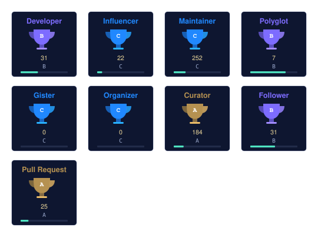
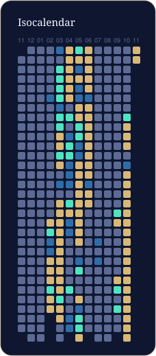
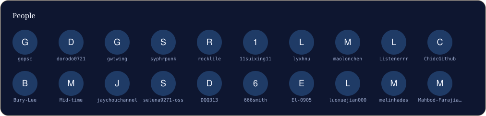

[English](README.md) | [中文](README.zh-CN.md) | [日本語](README.ja.md)

<p align="center">
  
</p>

<p align="center">
  
</p>

<p align="center"><sub>Slow is smooth, and smooth is fast.</sub></p>

<table border="0">
<tr>
<td valign="top" width="58%">

### About

My GitHub home for open tools, indexes, and small software experiments. Current work spans profile tooling, AI agents, and data-driven utilities.

</td>
<td valign="top" width="42%">

### Now

- Maintaining the API-Market and MCP-HUB indexes
- Advancing digilegacy and spark
- Documenting the 49-tool DU collection

</td>
</tr>
</table>

## Build

Profile asset compiler: writes README files and SVG cards from one Python data source, then mirrors them to GitCode and Gitee.

**Run it**

```bash
make gen       # rebuild README + every SVG from accounts.py
make verify    # offline gate: schema, asset refs, account isolation, idempotency
make release   # version / CHANGELOG / profile.json consistency
```

**Guarantee**

- Rendering never touches the network — same commit, same bytes
- One command rebuilds every asset: <code>make gen</code>
- Offline gate fails the build on a stale or foreign asset: <code>make verify</code>
- Single version source in <code>kit/version.py</code>, checked by <code>make release</code>

**Layout**

| Path | Purpose |
|---|---|
| `accounts.py` | single data source: accounts, copy, works catalogue |
| `kit/` | renderer package: textutil -> icons -> cards -> readme -> build |
| `data/*.json` | committed snapshots: stats, works, writing, extras |
| `scripts/` | refresh (only network component), verify, generate, release |
| `tests/` | stdlib unittest suite covering render, schema and gates |

## Toolbox

<p align="center">
  
</p>

## Selected work

| Project | Stars | Updated |
| --- | --- | --- |
| [moneyhelper — Chat-first personal finance agent — local-first, Lang…](https://github.com/badhope/moneyhelper) | 86 | 2026-11-02 |
| [spark — Local-first AI coding agent — approval gate, prompt-injecti…](https://github.com/badhope/spark) | 21 | 2026-11-02 |
| [content-harbor — Self-hosted AI publishing hub - write once, ship t…](https://github.com/badhope/content-harbor) | 11 | 2026-11-02 |
| [DU — A client-side Chinese metaphysics toolkit — 49 tools](https://github.com/badhope/DU) | 11 | 2026-11-02 |
| [sciflow — Local-first AI research agent workbench — multi-agent pip…](https://github.com/badhope/sciflow) | 11 | 2026-11-02 |
| [aquapilot — Topology-driven wastewater simulation prototype with an…](https://github.com/badhope/aquapilot) | 0 | 2026-11-02 |

All public repositories: [github.com/badhope](https://github.com/badhope)

## Numbers

<p align="center">
  
  
  
</p>

<p align="center">
  
  
</p>

## Achievements

<p align="center">
  
</p>

<p align="center">
  
</p>

<details>
<summary>Open source</summary>

Patches merged upstream into ohmyzsh, tldr, icalendar, NUR and more — details on the two GitHub accounts: [X33834](https://github.com/X33834) · [Morningstar202604](https://github.com/Morningstar202604)

</details>

## Activity

<p align="center">
  
</p>

<p align="center">
  
</p>

## Pinned work

<p align="center">
  
  
  
</p>

## Writing

| Date | Article |
|---|---|
| 2026-10-18 | [Gemini 4 Argon Opens to Everyone: Can Google's Half-Year Flagship Deliver?](https://blog.csdn.net/weixin_56622231/article/details/168251657) |
| 2026-10-16 | [A Year of MCP in Production: Six Engineering Truths Nobody Told Me](https://zhuanlan.zhihu.com/p/2094232145015453253) |
| 2026-10-16 | [Local-First AI: Why I Put AI Back on My Own Computer](https://zhuanlan.zhihu.com/p/2094233605513991576) |
| 2026-10-16 | [Five Gates Before Shipping an AI Agent: Notes from a Real Project](https://zhuanlan.zhihu.com/p/2094218858789856836) |
| 2026-09-27 | [Cross-Platform Playwright Delivery: Eight Pitfalls and Compliance Gates](https://blog.csdn.net/weixin_56622231/article/details/166698802) |

<sub>Also on  <a href="https://blog.csdn.net/weixin_56622231">CSDN</a> ·  <a href="https://juejin.cn/user/2350111542479753">Juejin</a> ·  <a href="https://www.zhihu.com/people/e7c851hd">Zhihu</a></sub>

## Elsewhere

> One identity, five homes — these five accounts mirror the same person.

| | Platform | Account | Role |
|---|---|---|---|
|  | GitHub | **[X33834](https://github.com/X33834)** | Upstream OSS · tools and works |
|  | GitHub | **[Morningstar202604](https://github.com/Morningstar202604)** | Portfolio · long-horizon works |
|  | GitHub | **[badhope](https://github.com/badhope)** | Profile · full-stack toolshop ◆ *you are here* |
|  | GitCode | **[badhope](https://gitcode.com/badhope)** | Mobile dev · offline tools |
|  | Gitee | **[badhope](https://gitee.com/badhope)** | Mirror · mini-programs |

<p align="center">
  
</p>

<p align="center"><sub>© badhope</sub></p>
