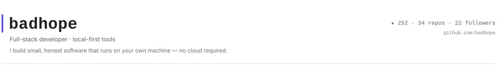
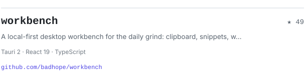
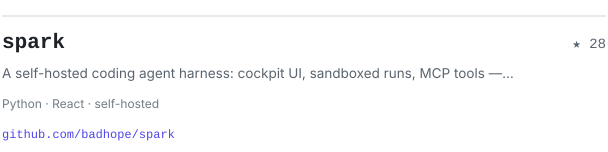
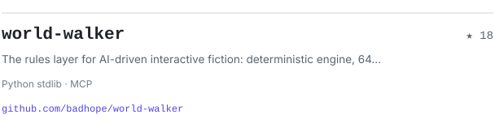

## Now

- **moneyhelper** — chat-first personal finance agent, local-first, numbers you can audit
- **workbench** — a desktop workbench (Tauri 2 + React) for daily driver tasks
- Upstream fixes: ohmyzsh, lefthook, betterleaks, scrapy

## Featured work

 

 

> More on the shelf: [DU](https://github.com/badhope/DU) · [mashang](https://github.com/badhope/mashang) · [digilegacy](https://github.com/badhope/digilegacy) · [harbor](https://github.com/badhope/harbor) · [sciflow](https://github.com/badhope/sciflow) · [pocketmind](https://github.com/badhope/pocketmind) · [aquapilot](https://github.com/badhope/aquapilot) · [melee](https://github.com/badhope/melee)

## Open source

| Upstream | Record |
| --- | --- |
| [ohmyzsh](https://github.com/ohmyzsh/ohmyzsh) | 3 merged · 3 under review |
| [renovate-operator](https://github.com/mogenius/renovate-operator) | 1 merged · 1 under review |
| [icalendar](https://github.com/python-icalendar/icalendar) | 3 merged |
| [apache/airflow](https://github.com/apache/airflow) | 1 merged |
| [betterleaks · lefthook · scrapy](https://github.com/betterleaks/betterleaks) | under review |

Tracked across this account and [X33834](https://github.com/X33834) / [Morningstar202604](https://github.com/Morningstar202604).

## Writing

- 2026-11-04 — [把 AI Agent 接进业务系统，我踩了3 个挺蠢的坑](https://blog.csdn.net/weixin_56622231/article/details/170051167)
- 2026-10-18 — [Gemini 4 Argon 全面开放：谷歌憋了半年的旗舰大招，到底行不行？](https://blog.csdn.net/weixin_56622231/article/details/168251657)
- 2026-10-16 — [MCP 落地一年，我总结了 6 个没人告诉你的工程真相](https://zhuanlan.zhihu.com/p/2094232145015453253)

CSDN · Juejin · Zhihu — <a href="https://blog.csdn.net/weixin_56622231">blog</a> · <a href="https://juejin.cn/user/2350111542479753">juejin</a> · <a href="https://www.zhihu.com/people/e7c851hd">zhihu</a>

**Toolbox** — Python · TypeScript / React · Kotlin · Tauri · FastAPI · Docker · SQLite

---

About this page

This page is generated by `build.py` from one data source — `make gen` rebuilds every byte, `make verify` proves it offline.

All public repositories: [github.com/badhope](https://github.com/badhope)
