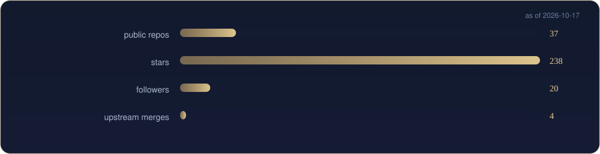

[English](README.md) | [中文](README.zh-CN.md) | [日本語](README.ja.md)

  

<i>A full-stack developer turning abstract ideas into working interfaces.</i>

First, solve the problem. Then, write the code. — John Johnson

<table border="0">
<tr>
<td valign="top" width="58%">

### About

My GitHub home — tools, indexes and small software experiments, all in the open. I like offline-first, single-file things that just run; the craft is in the details.

</td>
<td valign="top" width="42%">

### Now

- Maintaining the API-Market and MCP-HUB indexes
- Advancing digilegacy and spark
- Documenting the 49-tool DU collection

</td>
</tr>
</table>

## Toolbox

  

## Selected work

  

[DigiLegacy 归零](https://github.com/badhope/digilegacy) · [Spark](https://github.com/badhope/spark) · [Agent Builder](https://github.com/badhope/agent-builder) · [Workbench](https://github.com/badhope/workbench) · [SciFlow](https://github.com/badhope/sciflow) · [DU 渡](https://github.com/badhope/DU) · [API Market](https://github.com/badhope/API-Market) · [MCP Hub](https://github.com/badhope/MCP-HUB)

All public repositories: [github.com/badhope](https://github.com/badhope)

## Numbers

  
  

  

## Pinned work

  
  
  

## Contribution graph

  <picture>
    <source media="(prefers-color-scheme: dark)" srcset="./assets/github-contribution-grid-snake-dark.svg" />
    
  </picture>

## Open source

Patches merged upstream into ohmyzsh, tldr, icalendar, NUR and more — details on the two GitHub accounts: [X33834](https://github.com/X33834) · [Morningstar202604](https://github.com/Morningstar202604)

## Writing

| Date | Article |
|---|---|
| 2026-09-27 | [Playwright 多平台分发：8 个踩坑与合规门禁](https://blog.csdn.net/weixin_56622231/article/details/166698802) |
| 2026-09-25 | [AI Agent 智能体开发从零到一：2026年程序员完整学习路线与实战指南](https://blog.csdn.net/weixin_56622231/article/details/166643070) |
| 2026-09-21 | [工作流体检验收：全链路发布完整性验证](https://blog.csdn.net/weixin_56622231/article/details/166254273) |
| 2026-09-21 | [Python协程全景解析：从原理到生产实战](https://blog.csdn.net/weixin_56622231/article/details/166252941) |
| 2026-09-15 | [【分布式第一课】从单机到百万级并发：一小时带你看懂分布式系统的前世今生](https://blog.csdn.net/weixin_56622231/article/details/165435117) |

Also on  [CSDN](https://blog.csdn.net/weixin_56622231) ·  [Juejin](https://juejin.cn/user/2350111542479753)

## Elsewhere

> One identity, five homes — these five accounts mirror the same person.

| | Platform | Account | Role |
|---|---|---|---|
|  | GitHub | **[X33834](https://github.com/X33834)** | Upstream OSS · tools and works |
|  | GitHub | **[Morningstar202604](https://github.com/Morningstar202604)** | Portfolio · long-horizon works |
|  | GitHub | **[badhope](https://github.com/badhope)** | Profile · full-stack toolshop ◆ *you are here* |
|  | GitCode | **[badhope](https://gitcode.com/badhope)** | Mobile dev · offline tools |
|  | Gitee | **[badhope](https://gitee.com/badhope)** | Mirror · mini-programs |

  

© badhope

