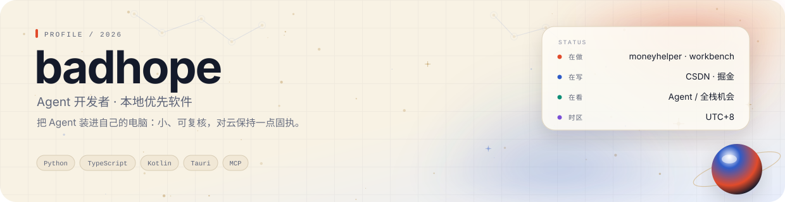
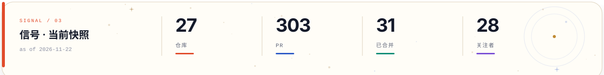
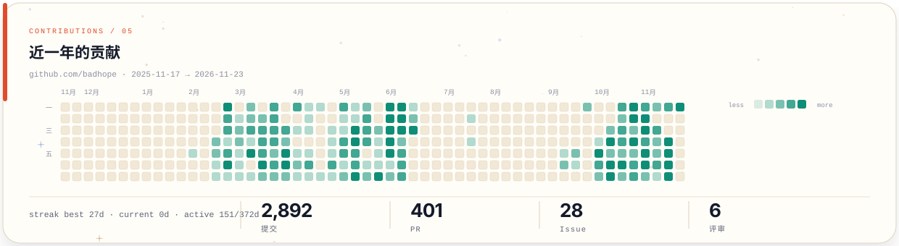
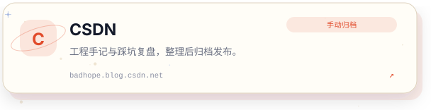
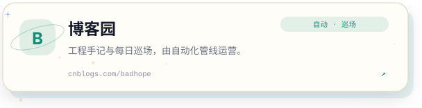

<a href="README.md">English</a> · <b>中文</b> · <a href="README.ja.md">日本語</a>

<picture><source media="(prefers-color-scheme: dark)" srcset="assets/hero-zh-CN-dark.svg" /></picture>

<picture><source media="(prefers-color-scheme: dark)" srcset="assets/starchart-zh-CN-dark.svg" /></picture>

缓慢旋转的星图 · 一圈一分钟

## 01 · 现在

- **个人仓库** — 27 个 · 个人命名空间，不含 fork
- **外部 PR** — 6 条：已合并 3，开放中 3，已关闭 0
- **发布** — CSDN 长文归档；掘金、知乎、博客园自动运营

## 02 · 外部 PR

6 条 · 已合并 3 · 开放中 3 · 已关闭 0 · +757/−67 · 39 个文件 · 8 条评论

- [mogenius/renovate-operator#796](https://github.com/mogenius/renovate-operator/pull/796) — feat(webhook): rotate the webhook auth token via an annotation · **开放中** · 开启于 2026-11-05 · +417/−23 · 14 个文件 · 2 条评论
- [ncepu-iDealStudio/Fast-Https#9](https://github.com/ncepu-iDealStudio/Fast-Https/pull/9) — fix: 三个深层问题——代理请求帧描述（走私）、两处限流失效、flaky 测试 · **已合并** · 合并于 2026-11-07 · +162/−36 · 11 个文件 · 1 条评论
- [evilmartians/lefthook#1629](https://github.com/evilmartians/lefthook/pull/1629) — fix: apply the staged-files fallback to pre-merge-commit · **开放中** · 开启于 2026-11-05 · +63/−2 · 5 个文件 · 1 条评论
- [sqlfluff/sqlfluff#9009](https://github.com/sqlfluff/sqlfluff/pull/9009) — Snowflake: parse an empty PACKAGES list · **已合并** · 合并于 2026-11-05 · +56/−2 · 3 个文件 · 1 条评论
- [mogenius/renovate-operator#772](https://github.com/mogenius/renovate-operator/pull/772) — feat(ui): add a check-all toggle to the log level filter · **已合并** · 合并于 2026-10-31 · +44/−0 · 3 个文件 · 0 条评论
- [betterleaks/betterleaks#456](https://github.com/betterleaks/betterleaks/pull/456) — fix(generic-api-key): detect base64 secrets that start with + or / · **开放中** · 开启于 2026-11-05 · +15/−4 · 3 个文件 · 3 条评论

PR 快照 2026-11-22 · GitHub Search / pulls API

## 03 · 参与项目

| 项目 | 技术栈 | 方向 |
|---|---|---|
| [harbor](https://github.com/badhope/harbor) | Python | 自托管发布枢纽；一份草稿分发 15 个渠道 |
| [spark](https://github.com/badhope/spark) | Python · React | 自托管编码智能体底座；沙箱执行、MCP 工具 |
| [moneyhelper](https://github.com/badhope/moneyhelper) | FastAPI · LangGraph · React | 对话式理财 Agent；记账、持仓风控、财报 |
| [workbench](https://github.com/badhope/workbench) | Tauri 2 · React 19 · TypeScript | 桌面工作台；剪贴板、片段、窗口、快速启动 |
| [world-walker](https://github.com/badhope/world-walker) | Python stdlib · MCP | AI 互动小说的确定性规则层 |
| [digilegacy](https://github.com/badhope/digilegacy) | Rust | 自托管数字遗产规划；资产、继承人、释放规则 |
| [sciflow](https://github.com/badhope/sciflow) | Python · TypeScript | 科研工作台；文献、实验记录、结构化写作 |
| [aquapilot](https://github.com/badhope/aquapilot) | TypeScript | 废水工艺模拟；可编辑流程、ASM1 |

## 04 · 数据

<picture><source media="(prefers-color-scheme: dark)" srcset="assets/numbers-zh-CN-dark.svg" /></picture>

## 05 · 贡献日历

<picture><source media="(prefers-color-scheme: dark)" srcset="assets/contrib-zh-CN-dark.svg" /></picture>

逐日贡献来自 GitHub GraphQL 精确快照 · 每周刷新

## 06 · 发布管线

<a href="https://blog.csdn.net/weixin_56622231"><picture><source media="(prefers-color-scheme: dark)" srcset="assets/channel-csdn-zh-CN-dark.svg" /></picture></a> <a href="https://juejin.cn/user/2350111542479753/posts"><picture><source media="(prefers-color-scheme: dark)" srcset="assets/channel-juejin-zh-CN-dark.svg" /></picture></a>

<a href="https://www.zhihu.com/people/e7c851hd"><picture><source media="(prefers-color-scheme: dark)" srcset="assets/channel-zhihu-zh-CN-dark.svg" /></picture></a> <a href="https://www.cnblogs.com/badhope"><picture><source media="(prefers-color-scheme: dark)" srcset="assets/channel-cnblogs-zh-CN-dark.svg" /></picture></a>

四个发布账号：CSDN 手动归档；掘金、知乎、博客园由自动化管线运营。

CSDN 最近

- 2026-11-04 — [把 AI Agent 接进业务系统，我踩了 3 个挺蠢的坑](https://blog.csdn.net/weixin_56622231/article/details/170051167)
- 2026-10-18 — [Gemini 4 Argon 全面开放：谷歌憋了半年的旗舰大招，到底行不行？](https://blog.csdn.net/weixin_56622231/article/details/168251657)

<a href="https://blog.csdn.net/weixin_56622231">CSDN 全部文章 →</a>

One source, five profiles · numbers from a local snapshot

全部仓库: [github.com/badhope](https://github.com/badhope)
