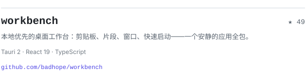
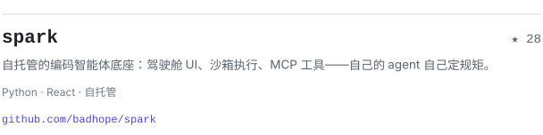

[English](README.md) · <b>中文</b> · [日本語](README.ja.md)

## 最近在做

- **moneyhelper** —— 对话优先的个人理财智能体，本地优先、数字可复核
- **workbench** —— 日常驾驶舱级桌面工作台（Tauri 2 + React）
- 上游修复进行中：ohmyzsh、lefthook、betterleaks、scrapy

## 代表作品

 

 

> 架子上还有：[DU](https://github.com/badhope/DU) · [mashang](https://github.com/badhope/mashang) · [digilegacy](https://github.com/badhope/digilegacy) · [harbor](https://github.com/badhope/harbor) · [sciflow](https://github.com/badhope/sciflow) · [pocketmind](https://github.com/badhope/pocketmind) · [aquapilot](https://github.com/badhope/aquapilot) · [melee](https://github.com/badhope/melee)

## 活跃轨迹

<picture>
  <source media="(prefers-color-scheme: dark)" srcset="https://raw.githubusercontent.com/badhope/badhope/output/github-contribution-grid-snake-dark.svg" />
  
</picture>

## 开源贡献

| Upstream | Record |
| --- | --- |
| [ohmyzsh](https://github.com/ohmyzsh/ohmyzsh) | 3 merged · 3 under review |
| [renovate-operator](https://github.com/mogenius/renovate-operator) | 1 merged · 1 under review |
| [icalendar](https://github.com/python-icalendar/icalendar) | 3 merged |
| [apache/airflow](https://github.com/apache/airflow) | 1 merged |
| [betterleaks · lefthook · scrapy](https://github.com/betterleaks/betterleaks) | under review |

记录横跨本账号与 [X33834](https://github.com/X33834) / [Morningstar202604](https://github.com/Morningstar202604)。

## 数据

  <a href="https://github.com/badhope"><picture><source media="(prefers-color-scheme: dark)" srcset="https://github-readme-stats.vercel.app/api?username=badhope&amp;show_icons=true&amp;hide_border=true&amp;include_all_commits=true&amp;theme=github_dark" /></picture></a>
  <a href="https://github.com/badhope"><picture><source media="(prefers-color-scheme: dark)" srcset="https://streak-stats.demolab.com?user=badhope&amp;hide_border=true&amp;border_radius=0&amp;background=0D1117&amp;border=30363D&amp;stroke=4F46E5&amp;ring=A5B4FC&amp;fire=D9B876&amp;currStreakNum=E6EDF3&amp;sideNums=E6EDF3&amp;currStreakLabel=8B949E&amp;sideLabels=8B949E&amp;dates=8B949E" /></picture></a>
  <a href="https://github.com/badhope"><picture><source media="(prefers-color-scheme: dark)" srcset="https://github-readme-stats.vercel.app/api/top-langs/?username=badhope&amp;layout=compact&amp;hide_border=true&amp;langs_count=8&amp;theme=github_dark" /></picture></a>

## 写作

- 2026-11-04 — [把 AI Agent 接进业务系统，我踩了3 个挺蠢的坑](https://blog.csdn.net/weixin_56622231/article/details/170051167)
- 2026-10-18 — [Gemini 4 Argon 全面开放：谷歌憋了半年的旗舰大招，到底行不行？](https://blog.csdn.net/weixin_56622231/article/details/168251657)
- 2026-10-16 — [MCP 落地一年，我总结了 6 个没人告诉你的工程真相](https://zhuanlan.zhihu.com/p/2094232145015453253)

CSDN · Juejin · Zhihu — <a href="https://blog.csdn.net/weixin_56622231">blog</a> · <a href="https://juejin.cn/user/2350111542479753">juejin</a> · <a href="https://www.zhihu.com/people/e7c851hd">zhihu</a>

**工具箱** — Python · TypeScript / React · Kotlin · Tauri · FastAPI · Docker · SQLite

---

关于本页

This page is generated by `build.py` from one data source — `make gen` rebuilds every byte, `make verify` proves it offline.

All public repositories: [github.com/badhope](https://github.com/badhope)
