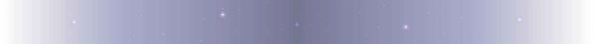

<!--
  中文镜像版本。结构与 README.md 完全一致。
  "AUTO:KEY:START" / "AUTO:KEY:END" 注释对之间的内容由
  `python scripts/generate.py` 同步刷新（见 DEPLOYMENT.md）。
-->

  
    🌐 <a href="./README.md">English</a> · <b>中文</b>
  

 

  

 
 

  

 

<h1 align="center" style="font-size:72px;font-weight:700;letter-spacing:6px;margin:12px 0 6px;background:linear-gradient(135deg,#FBBF24 0%,#FDE68A 35%,#A78BFA 75%,#67E8F9 100%);-webkit-background-clip:text;background-clip:text;color:transparent">badhope</h1>

— 仰望星空 · 慢慢写码 —

  <a href="https://readme-typing-svg.demolab.com?font=Cormorant+Garamond&size=36&duration=4000&pause=900&color=A78BFA&center=true&vCenter=true&multiline=true&width=940&height=185&separator=%7C&lines=%E9%80%A0%E6%88%91%E6%89%80%E6%84%BF%EF%BC%8C%E8%A1%8C%E6%88%91%E6%9C%AA%E8%87%B3%E3%80%82|Python%20%C2%B7%20TypeScript%20%C2%B7%20Rust%20%C2%B7%20Postgres|%E4%BB%A5%E6%98%9F%E8%BE%B0%E4%B8%BA%E8%B7%AF%E6%A0%87%EF%BC%8C%E4%BB%A5%E4%BB%A3%E7%A0%81%E4%B8%BA%E8%88%9F%E3%80%82|%E4%BB%A3%E7%A0%81%E6%98%AF%E6%88%91%E7%9A%84%E6%98%9F%E5%9B%BE%EF%BC%8C%E5%AE%87%E5%AE%99%E6%98%AF%E6%88%91%E7%9A%84%20IDE%E3%80%82|%E6%98%9F%E8%BE%B0%E5%A4%A7%E6%B5%B7%EF%BC%8C%E7%9A%86%E5%9C%A8%20git%20log%E3%80%82|%E5%90%91%E6%98%9F%E9%87%8E%20commit%EF%BC%8C%E5%90%91%E5%A4%9C%E7%A9%BA%20deploy%E3%80%82">
    
  </a>

  深圳 · <a href="https://badhope.github.io/github.io/">badhope.github.io</a>

 
 

---

 

<h2 style="font-size:32px;font-weight:700;letter-spacing:2px;border-bottom:1px solid rgba(167,139,250,0.30);padding-bottom:10px;margin:18px 0 18px">📜 来自 badhope 的一封信</h2>

我在<strong>语言模型</strong>和<strong>普通软件</strong>的交界处造东西。LLM 很少是产品本身，但常常是产品的灵魂。乏味的部分才是工作真正栖息的地方。有趣的部分是一个开关。

 

<blockquote style="font-size:18px;color:#FBBF24;line-height:1.7;font-style:italic;margin:6px 0;border-left:3px solid rgba(251,191,36,0.4);padding:4px 0 4px 16px">
千里之行，始于凌晨三点的咖啡。
</blockquote>

 

---

<h2 style="font-size:32px;font-weight:700;letter-spacing:2px;border-bottom:1px solid rgba(167,139,250,0.30);padding-bottom:10px;margin:18px 0 18px">⌘ 技术宇宙</h2>

工具就这些。不花哨。

 

  

  

---

<h2 style="font-size:32px;font-weight:700;letter-spacing:2px;border-bottom:1px solid rgba(167,139,250,0.30);padding-bottom:10px;margin:28px 0 18px">⭐ 精选星图</h2>

 

⭐ 排前 6 的项目。星星不同意我 —— 我更喜欢 [Personal-Assistant](https://github.com/badhope/Personal-Assistant) 胜过 [MindMirror](https://github.com/badhope/MindMirror)。

<!-- AUTO:FEATURED:START -->
<h3 style="font-size:21px;font-weight:700;letter-spacing:0.3px;margin:18px 0 6px"><a href="https://github.com/badhope/MindMirror" style="color:#c4b5fd;text-decoration:none">MindMirror</a> ⭐ 67 🟦 TypeScript</h3>

Open-source, self-hostable, privacy-first psychological assessment platform. Big Five (IPIP/NEO-PI-R), PSS-10…

<h3 style="font-size:21px;font-weight:700;letter-spacing:0.3px;margin:18px 0 6px"><a href="https://github.com/badhope/Personal-Assistant" style="color:#c4b5fd;text-decoration:none">Personal-Assistant</a> ⭐ 41 🟦 TypeScript</h3>

Pipeline-driven personal AI agent: 10 LLM providers, 7 real tools, 6-stage pipeline, React Web UI + CLI. Zero…

<h3 style="font-size:21px;font-weight:700;letter-spacing:0.3px;margin:18px 0 6px"><a href="https://github.com/badhope/DATA-AI" style="color:#c4b5fd;text-decoration:none">DATA-AI</a> ⭐ 21 🐍 Python</h3>

DATA-AI — a self-hosted single-backend AI agent platform. FastAPI + React 19 with streaming chat,…

<h3 style="font-size:21px;font-weight:700;letter-spacing:0.3px;margin:18px 0 6px"><a href="https://github.com/badhope/national_stats" style="color:#c4b5fd;text-decoration:none">national_stats</a> ⭐ 15 🐍 Python</h3>

Regional Economic Analysis Platform — FastAPI + zero-build SPA. 10 Chinese cities, 4 analysis scenarios…

<h3 style="font-size:21px;font-weight:700;letter-spacing:0.3px;margin:18px 0 6px"><a href="https://github.com/badhope/AI-SKILL" style="color:#c4b5fd;text-decoration:none">AI-SKILL</a> ⭐ 11 🐍 Python</h3>

A curated catalog of 5,452 agent skills across 49 categories — open-source prompt templates, agent…

<h3 style="font-size:21px;font-weight:700;letter-spacing:0.3px;margin:18px 0 6px"><a href="https://github.com/badhope/TaskFlow" style="color:#c4b5fd;text-decoration:none">TaskFlow</a> ⭐ 11 🟦 TypeScript</h3>

TaskFlow — A modern, cross-platform (Web / Android / iOS) todo & task management app. AI suggestions,…

<!-- AUTO:FEATURED:END -->

 

  

 

  <em>这东西在转。慢慢地。你没注意到。没关系。</em>

  <em>万物负阴而抱阳，冲气以为和。</em>

 

---

<h2 style="font-size:32px;font-weight:700;letter-spacing:2px;border-bottom:1px solid rgba(167,139,250,0.30);padding-bottom:10px;margin:18px 0 18px">🌌 全部可见的星</h2>

 

⭐ 排前 9 的拿卡片。剩下的丢进"长尾"。

<!-- AUTO:REPOS_GRID:START -->
<table role="presentation" width="100%" cellspacing="0" cellpadding="0" style="border-collapse:separate;border-spacing:0;margin:8px 0 16px"><tr><td valign="top" width="33.3%" style="padding:6px">

<a href="https://github.com/badhope/MindMirror" style="color:#c4b5fd;font-weight:600;font-size:16px;text-decoration:none;letter-spacing:0.2px">MindMirror</a>⭐ 67

🟦 TypeScript  ·  ⑂ 9

Open-source, self-hostable, privacy-first psychological assessment platform. Big Five…

anxiety-assessment big-five cbt

</td><td valign="top" width="33.3%" style="padding:6px">

<a href="https://github.com/badhope/Personal-Assistant" style="color:#c4b5fd;font-weight:600;font-size:16px;text-decoration:none;letter-spacing:0.2px">Personal-Assistant</a>⭐ 41

🟦 TypeScript  ·  ⑂ 7

Pipeline-driven personal AI agent: 10 LLM providers, 7 real tools, 6-stage pipeline, React Web…

ai-agent anthropic chatbot

</td><td valign="top" width="33.3%" style="padding:6px">

<a href="https://github.com/badhope/DATA-AI" style="color:#c4b5fd;font-weight:600;font-size:16px;text-decoration:none;letter-spacing:0.2px">DATA-AI</a>⭐ 21

🐍 Python  ·  ⑂ 4

DATA-AI — a self-hosted single-backend AI agent platform. FastAPI + React 19 with streaming…

agent-framework ai-agent anthropic

</td></tr><tr><td valign="top" width="33.3%" style="padding:6px">

<a href="https://github.com/badhope/national_stats" style="color:#c4b5fd;font-weight:600;font-size:16px;text-decoration:none;letter-spacing:0.2px">national_stats</a>⭐ 15

🐍 Python  ·  ⑂ 1

Regional Economic Analysis Platform — FastAPI + zero-build SPA. 10 Chinese cities, 4 analysis…

accessibility china-regional-economy data-visualization

</td><td valign="top" width="33.3%" style="padding:6px">

<a href="https://github.com/badhope/AI-SKILL" style="color:#c4b5fd;font-weight:600;font-size:16px;text-decoration:none;letter-spacing:0.2px">AI-SKILL</a>⭐ 11

🐍 Python  ·  ⑂ 0

A curated catalog of 5,452 agent skills across 49 categories — open-source prompt templates,…

agent agent-frameworks ai

</td><td valign="top" width="33.3%" style="padding:6px">

<a href="https://github.com/badhope/TaskFlow" style="color:#c4b5fd;font-weight:600;font-size:16px;text-decoration:none;letter-spacing:0.2px">TaskFlow</a>⭐ 11

🟦 TypeScript  ·  ⑂ 1

TaskFlow — A modern, cross-platform (Web / Android / iOS) todo & task management app. AI…

ai-suggestions android cross-platform

</td></tr><tr><td valign="top" width="33.3%" style="padding:6px">

<a href="https://github.com/badhope/mistverse" style="color:#c4b5fd;font-weight:600;font-size:16px;text-decoration:none;letter-spacing:0.2px">mistverse</a>⭐ 9

🟩 Vue  ·  ⑂ 2

MISTVERSE — 命理/占卜/古物/健康/修心/生活/AI 七大领域 49 工具的一站式玄学工具箱 (uni-app x · Vue 3 · TypeScript strict…

bazi chinese-culture divination

</td><td valign="top" width="33.3%" style="padding:6px">

<a href="https://github.com/badhope/NetTools-Hub" style="color:#c4b5fd;font-weight:600;font-size:16px;text-decoration:none;letter-spacing:0.2px">NetTools-Hub</a>⭐ 8

🟦 TypeScript  ·  ⑂ 0

🛠️ One-stop navigation for 120+ actively-maintained open-source network tools (proxies, VPNs,…

clash directory dns

</td><td valign="top" width="33.3%" style="padding:6px">

<a href="https://github.com/badhope/MCP-HUB" style="color:#c4b5fd;font-weight:600;font-size:16px;text-decoration:none;letter-spacing:0.2px">MCP-HUB</a>⭐ 6

🐍 Python  ·  ⑂ 0

MCP Hub — A free, open-source registry of 4,403+ Model Context Protocol servers, prompts, and…

ai-agents ai-tools claude

</td></tr></table>
<!-- AUTO:REPOS_GRID:END -->

 

<h3 style="font-size:20px;font-weight:600;letter-spacing:0.8px;color:#c4b5fd;margin:24px 0 10px">长尾</h3>

<!-- AUTO:REPOS_TAIL:START -->

<a href="https://github.com/badhope/DocFormatConverter" style="color:#c4b5fd;text-decoration:none;background:rgba(49,46,129,0.30);border:1px solid rgba(167,139,250,0.18);padding:4px 11px;border-radius:12px;font-size:13px;display:inline-block;margin:3px 5px 3px 0;letter-spacing:0;line-height:1.6">DocFormatConverter&nbsp;⭐ 4· 🐍 Python</a><a href="https://github.com/badhope/ScholarLib" style="color:#c4b5fd;text-decoration:none;background:rgba(49,46,129,0.30);border:1px solid rgba(167,139,250,0.18);padding:4px 11px;border-radius:12px;font-size:13px;display:inline-block;margin:3px 5px 3px 0;letter-spacing:0;line-height:1.6">ScholarLib&nbsp;⭐ 4· 📜 TeX</a><a href="https://github.com/badhope/AI-Dev-Config" style="color:#c4b5fd;text-decoration:none;background:rgba(49,46,129,0.30);border:1px solid rgba(167,139,250,0.18);padding:4px 11px;border-radius:12px;font-size:13px;display:inline-block;margin:3px 5px 3px 0;letter-spacing:0;line-height:1.6">AI-Dev-Config&nbsp;⭐ 3· 🐚 Shell</a><a href="https://github.com/badhope/Data-Agent" style="color:#c4b5fd;text-decoration:none;background:rgba(49,46,129,0.30);border:1px solid rgba(167,139,250,0.18);padding:4px 11px;border-radius:12px;font-size:13px;display:inline-block;margin:3px 5px 3px 0;letter-spacing:0;line-height:1.6">Data-Agent&nbsp;⭐ 3· 🐍 Python</a><a href="https://github.com/badhope/forever" style="color:#c4b5fd;text-decoration:none;background:rgba(49,46,129,0.30);border:1px solid rgba(167,139,250,0.18);padding:4px 11px;border-radius:12px;font-size:13px;display:inline-block;margin:3px 5px 3px 0;letter-spacing:0;line-height:1.6">forever&nbsp;⭐ 3· 🟦 TypeScript</a><a href="https://github.com/badhope/Thesis-Specialist-Agent" style="color:#c4b5fd;text-decoration:none;background:rgba(49,46,129,0.30);border:1px solid rgba(167,139,250,0.18);padding:4px 11px;border-radius:12px;font-size:13px;display:inline-block;margin:3px 5px 3px 0;letter-spacing:0;line-height:1.6">Thesis-Specialist-Agent&nbsp;⭐ 3· 🐍 Python</a><a href="https://github.com/badhope/WindowsTools" style="color:#c4b5fd;text-decoration:none;background:rgba(49,46,129,0.30);border:1px solid rgba(167,139,250,0.18);padding:4px 11px;border-radius:12px;font-size:13px;display:inline-block;margin:3px 5px 3px 0;letter-spacing:0;line-height:1.6">WindowsTools&nbsp;⭐ 3· 🦀 Rust</a><a href="https://github.com/badhope/miru-index" style="color:#c4b5fd;text-decoration:none;background:rgba(49,46,129,0.30);border:1px solid rgba(167,139,250,0.18);padding:4px 11px;border-radius:12px;font-size:13px;display:inline-block;margin:3px 5px 3px 0;letter-spacing:0;line-height:1.6">miru-index&nbsp;⭐ 2· 🟨 JavaScript</a><a href="https://github.com/badhope/OnlineCode" style="color:#c4b5fd;text-decoration:none;background:rgba(49,46,129,0.30);border:1px solid rgba(167,139,250,0.18);padding:4px 11px;border-radius:12px;font-size:13px;display:inline-block;margin:3px 5px 3px 0;letter-spacing:0;line-height:1.6">OnlineCode&nbsp;⭐ 2· 🟦 TypeScript</a><a href="https://github.com/badhope/API-Market" style="color:#c4b5fd;text-decoration:none;background:rgba(49,46,129,0.30);border:1px solid rgba(167,139,250,0.18);padding:4px 11px;border-radius:12px;font-size:13px;display:inline-block;margin:3px 5px 3px 0;letter-spacing:0;line-height:1.6">API-Market&nbsp;⭐ 1· 🟦 TypeScript</a><a href="https://github.com/badhope/CET6-Option-Strategy" style="color:#c4b5fd;text-decoration:none;background:rgba(49,46,129,0.30);border:1px solid rgba(167,139,250,0.18);padding:4px 11px;border-radius:12px;font-size:13px;display:inline-block;margin:3px 5px 3px 0;letter-spacing:0;line-height:1.6">CET6-Option-Strategy&nbsp;⭐ 1· 🐍 Python</a><a href="https://github.com/badhope/OptionDecoder" style="color:#c4b5fd;text-decoration:none;background:rgba(49,46,129,0.30);border:1px solid rgba(167,139,250,0.18);padding:4px 11px;border-radius:12px;font-size:13px;display:inline-block;margin:3px 5px 3px 0;letter-spacing:0;line-height:1.6">OptionDecoder&nbsp;⭐ 1· 🐍 Python</a>

<!-- AUTO:REPOS_TAIL:END -->

<!-- AUTO:SUMMARY:START -->
_As of 2026-06-08 UTC — 21 public repos · 219 total ⭐ · top languages: Python (9), TypeScript (7) + 5 more._
<!-- AUTO:SUMMARY:END -->

---

  

---

<h2 style="font-size:32px;font-weight:700;letter-spacing:2px;border-bottom:1px solid rgba(167,139,250,0.30);padding-bottom:10px;margin:28px 0 18px">📊 用数字说话</h2>

 

<h3 style="font-size:20px;font-weight:600;letter-spacing:0.8px;color:#c4b5fd;margin:18px 0 10px">我活在哪些语言里</h3>

<!-- AUTO:LANG_BARS:START -->

🐍 Python██████████████████████9 · 43%

🟦 TypeScript█████████████████7 · 33%

🟩 Vue██1 · 5%

📜 TeX██1 · 5%

🟨 JavaScript██1 · 5%

🦀 Rust██1 · 5%

🐚 Shell██1 · 5%

<!-- AUTO:LANG_BARS:END -->

<h3 style="font-size:20px;font-weight:600;letter-spacing:0.8px;color:#c4b5fd;margin:24px 0 10px">我反复回到哪些主题</h3>

<!-- AUTO:TOPIC_CLOUD:START -->

fastapi×5llm×5vite×5react×4ai-agent×3deepseek×3machine-learning×3nextjs×3ai×2anthropic×2big-five×2chatbot×2claude×2cursor×2data-analysis×2data-driven×2developer-tools×2directory×2index×2multi-agent×2openai×2pwa×2rag×2rest-api×2task-management×2academic-papers×1academic-writing×1accessibility×1acg×1agent×1

<!-- AUTO:TOPIC_CLOUD:END -->

---

<h2 style="font-size:32px;font-weight:700;letter-spacing:2px;border-bottom:1px solid rgba(167,139,250,0.30);padding-bottom:10px;margin:28px 0 18px">📰 最新发文</h2>

 

长文写在 CSDN。我不做交叉发布。这个 feed 每天刷一次；我的回信等不了那么久。

<!-- AUTO:CSDN:START -->
- [`2026-06-07`](https://blog.csdn.net/weixin_56622231/article/details/161770627) — AI提示词极限赛：从入门到精通的技术全景与实战指南
- [`2026-06-07`](https://blog.csdn.net/weixin_56622231/article/details/161767736) — 2026年AI与机器人领域五大突破，5月科技大事了解
- [`2026-06-04`](https://blog.csdn.net/weixin_56622231/article/details/161685491) — PyCharm全面了解以及下载途径和使用方法指南
- [`2026-06-04`](https://blog.csdn.net/weixin_56622231/article/details/161685670) — 什么是异步？Python 开发者必懂的 20 个“黑话”术语
- [`2026-06-04`](https://blog.csdn.net/weixin_56622231/article/details/161685266) — 机器学习三要素：模型、策略与算法(附实战代码)
<!-- AUTO:CSDN:END -->

---

  

---

<h2 style="font-size:32px;font-weight:700;letter-spacing:2px;border-bottom:1px solid rgba(167,139,250,0.30);padding-bottom:10px;margin:28px 0 18px">🌙 每日的反刍</h2>

 

每个 UTC 日抓一次。别读两遍 —— 那就废了。

<!-- AUTO:QUOTE:START -->
> *"The only way to do great work is to love what you do."*
> 
> — **Steve Jobs**
<!-- AUTO:QUOTE:END -->

---

<h2 style="font-size:32px;font-weight:700;letter-spacing:2px;border-bottom:1px solid rgba(167,139,250,0.30);padding-bottom:10px;margin:28px 0 18px">🏆 奖杯 （手数的，<em>不是</em> github-trophy 那种）</h2>

 

| 奖杯 | 来历 |
|:---|:---|
| 🏆 **Pair Extraordinaire** | 在别人的仓库里合过 PR。或者反过来。记忆模糊。 |
| 🏆 **Pull Shark ×2** | 据称。鲨鱼在我经验里是 merge-conflict 免疫的。 |
| 🏆 **Quickdraw** | 在用户打完字之前关掉了一个 issue。是个拼写错误。 |
| 🏆 **YOLO** | 周五合并到 `main`。没事。又出事了。又没事。 |
| 🏆 **Arctic Code Vault** | 2020 年北极代码库的快照里有我的代码。已经不新了。 |

 

---

  

---

<h2 style="font-size:32px;font-weight:700;letter-spacing:2px;border-bottom:1px solid rgba(167,139,250,0.30);padding-bottom:10px;margin:28px 0 18px">📫 找到我</h2>

 

<ul style="font-size:17px;line-height:2.0;list-style:none;padding-left:0;max-width:780px">
  <li>📝 <strong>Issue</strong> — 最快。在任何仓库开一个；每一个我都看。</li>
  <li>📚 <strong>CSDN</strong> — 用来写长的。<https://blog.csdn.net/weixin_56622231></li>
  <li>📧 <strong>邮件</strong> — 见我 profile 上的置顶 gist</li>
  <li>☕ <strong>当面</strong> — 深圳，港口附近，一杯咖啡</li>
</ul>

这个 README 有一半是生成的。静态文字是我的。仓库列表、CSDN feed 和每日一言由 `python scripts/generate.py` 刷新（见 [DEPLOYMENT.md](./DEPLOYMENT.md)）。太极一分钟转一圈。其它的，时间尺度更长。
