[English](README.md) | [中文](README.zh-CN.md) | [日本語](README.ja.md)

  <picture>
  <source type="image/png" srcset="./assets/png/hero.png" />
  
  </picture>

<i>把抽象想法落地为可交互界面的全栈开发者。</i>

先解决问题，再写代码。 — John Johnson

<table border="0">
<tr>
<td valign="top" width="58%">

### 关于

这是我在 GitHub 的主页：工具、索引与小型软件实验都公开在这里。偏爱离线优先、单文件、拿起来就能跑的小东西 —— 精巧之处藏在细节里。

</td>
<td valign="top" width="42%">

### 近期

- 维护 API-Market / MCP-HUB 两个索引的数据
- digilegacy 与 spark 持续迭代
- 整理 49 件术数工具集（DU）的文档

</td>
</tr>
</table>

## 工具箱

  

## 精选作品

| 项目 | 星标 | 最近更新 |
| --- | --- | --- |
| [rubbish — ScholarHub — multi-tenant academic journal &amp; preprint pla…](https://github.com/badhope/rubbish) | 4 | 2026-10-26 |
| [zhike — Zhike — self-hosted agent harness for personal assistants:…](https://github.com/badhope/zhike) | 0 | 2026-10-26 |
| [xiaoman — Xiaoman (小满) — a conversation-first, local-first personal…](https://github.com/badhope/xiaoman) | 85 | 2026-10-25 |
| [workbench — Workbench - a local-first desktop workbench (Tauri 2 +…](https://github.com/badhope/workbench) | 48 | 2026-10-25 |
| [spark — Spark — local-first coding agent (Python + React), self-hos…](https://github.com/badhope/spark) | 21 | 2026-10-25 |
| [sciflow — SciFlow - fully automated AI research assistant: local-fi…](https://github.com/badhope/sciflow) | 12 | 2026-10-25 |

全部公开仓库： [github.com/badhope](https://github.com/badhope)

## 数据

  
  
  

  
  

## 置顶作品

  
  
  

## 贡献图

  <picture>
  <source media="(prefers-color-scheme: dark)" srcset="./assets/github-contribution-grid-snake-dark.svg" />
  
  </picture>

## 开源足迹

补丁已合入 ohmyzsh · tldr · icalendar · NUR 等上游项目，明细见两个 GitHub 账号: [X33834](https://github.com/X33834) · [Morningstar202604](https://github.com/Morningstar202604)

## 写作

| 日期 | 文章 |
|---|---|
| 2026-10-18 | [Gemini 4 Argon 全面开放：谷歌憋了半年的旗舰大招，到底行不行？](https://blog.csdn.net/weixin_56622231/article/details/168251657) |
| 2026-10-16 | [MCP 落地一年，我总结了 6 个没人告诉你的工程真相](https://zhuanlan.zhihu.com/p/2094232145015453253) |
| 2026-10-16 | [本地优先 AI：当所有人都在上云，我为什么把 AI 装回自己电脑](https://zhuanlan.zhihu.com/p/2094233605513991576) |
| 2026-10-16 | [AI Agent 上线前必须过的 5 道关：一个真实项目的工程手记](https://zhuanlan.zhihu.com/p/2094218858789856836) |
| 2026-09-27 | [Playwright 多平台分发：8 个踩坑与合规门禁](https://blog.csdn.net/weixin_56622231/article/details/166698802) |

同步发布  <a href="https://blog.csdn.net/weixin_56622231">CSDN</a> ·  <a href="https://juejin.cn/user/2350111542479753">Juejin</a> ·  <a href="https://www.zhihu.com/people/e7c851hd">Zhihu</a>

## 在别处

> 同一身份，五处安放 —— 这五个账号同属一人，互为镜像。

| | 平台 | 账号 | 定位 |
|---|---|---|---|
|  | GitHub | **[X33834](https://github.com/X33834)** | 上游开源 · 工具与作品 |
|  | GitHub | **[Morningstar202604](https://github.com/Morningstar202604)** | 作品集 · 长期项目 |
|  | GitHub | **[badhope](https://github.com/badhope)** | 个人主页 · 全栈工具馆 ◆ *你在这里* |
|  | GitCode | **[badhope](https://gitcode.com/badhope)** | 移动端开发 · 离线工具 |
|  | Gitee | **[badhope](https://gitee.com/badhope)** | 作品镜像 · 小程序 |

  

© badhope

